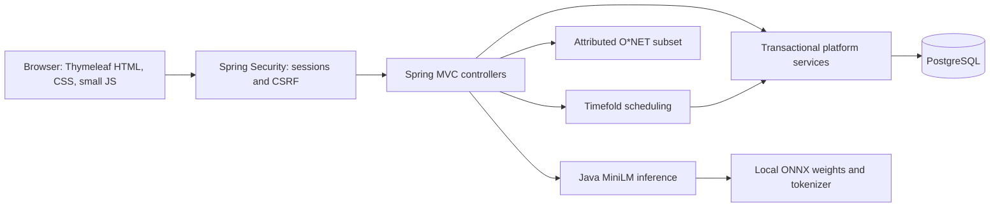
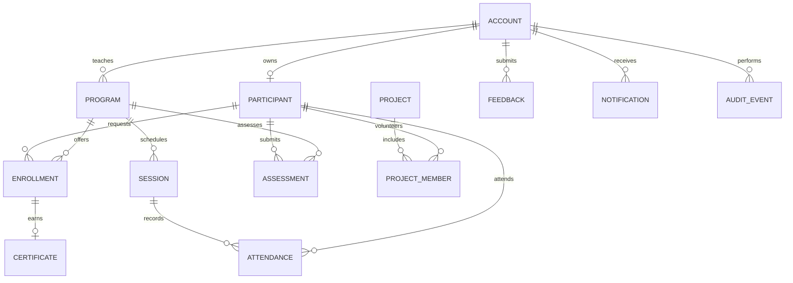

# Architecture and workflows

## Scope

The platform supports voluntary rehabilitation programs and community projects. It does not manage convictions, discipline, parole, medical records, payments, or compulsory labour. Personal interests guide opportunities; staff make suitability decisions with participants.

## Components

## Core data relationships

## Enrollment states

- Participant requests create `REQUESTED` records.
- Staff-assisted enrollment creates `ENROLLED` when capacity and schedules allow, otherwise `WAITLISTED`.
- Officers/admins approve requested or waitlisted records after reviewing prerequisites.
- Active/requested/waitlisted records can be cancelled by their participant or staff.
- Only staff or the assigned instructor can complete an active enrollment. Attendance must meet the configured session count and the best knowledge check must be at least 70%.
- Completion creates a unique UUID credential in the same transaction. Repeated completion is rejected.
- Cancelled records can be requested again. Completion history remains immutable through the supported workflows.

## Concurrency

Seat decisions take a `FOR UPDATE` lock on the program row. A shared transaction-scoped PostgreSQL advisory lock serializes enrollment membership changes with timetable writes, protecting against a different-program participant conflict that row locking alone would miss. The lock is held only for transaction duration. The solver runs inside this coordinator transaction for at most two seconds and validates the result before committing. This favors correctness and simplicity at pilot scale; larger deployments should separate plan proposal from short, version-checked commit transactions.

## Authorization matrix

| Capability | Participant | Instructor | Officer | Admin |
| --- | --- | --- | --- | --- |
| Browse catalog | Yes | Yes | Yes | Yes |
| View personal profiles | Own | Assigned enrolled/completed | All | All |
| Request enrollment | Own | No | Assisted | Assisted |
| Approve enrollment | No | No | Yes | Yes |
| Schedule sessions | No | Assigned programs | All | All |
| Record attendance/complete | No | Assigned programs | All | All |
| Take quiz | Own active enrollment | No | No | No |
| Read feedback | Own | Own | All | All |
| Account administration | No | No | No | Yes |
| Public verification | Minimal non-identifying record | Same | Same | Same |

All state-changing forms require CSRF tokens. SQL parameters are bound rather than interpolating user input. Thymeleaf escapes displayed user text. Application errors use non-sensitive messages. Sensitive profile content is not sent to external ML services.

## What counts as a working release

A clean database migrates and seeds once; all four roles can sign in; profile and catalog data persist; requests/approval/cancellation enforce ownership and capacity; scheduling rejects conflicts; instructors record attendance; participants submit assessments; certificates follow verified completion; community progress cannot exceed targets; feedback and notifications respect ownership; ML inference is genuine and its fallback is labelled; automated checks pass and representative workflows are inspected in a browser.
