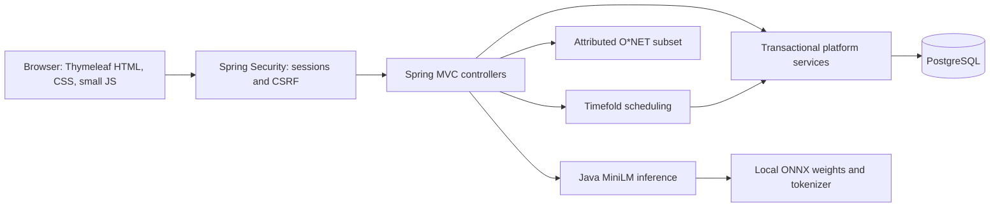
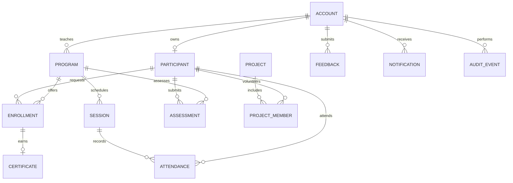
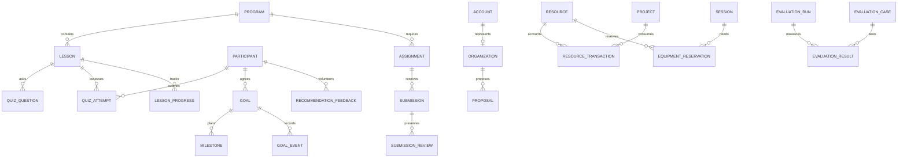

# Architecture and workflows

## Scope

The platform supports voluntary rehabilitation programs and community projects. It does not manage convictions, discipline, parole, medical records, payments, or compulsory labour. Personal interests guide opportunities; staff make suitability decisions with participants.

## Components

## Core data relationships

## Enrollment states

- Participant requests create `REQUESTED` records.
- Staff-assisted enrollment creates `ENROLLED` when capacity and schedules allow, otherwise `WAITLISTED`.
- Officers/admins approve requested or waitlisted records after reviewing prerequisites.
- Active/requested/waitlisted records can be cancelled by their participant or staff.
- Only staff or the assigned instructor can complete an active enrollment. Attendance must meet the configured session count. Every required lesson must be marked read, each required lesson quiz must have an attempt of at least 70%, and every required written/practical assessment must be instructor-passed. Legacy-only courses retain their prior knowledge-check rule.
- Completion creates a unique UUID credential in the same transaction. Repeated completion is rejected.
- Cancelled records can be requested again. Completion history remains immutable through the supported workflows.

## Concurrency

Seat decisions take a `FOR UPDATE` lock on the program row. A shared transaction-scoped PostgreSQL advisory lock serializes enrollment membership changes with timetable writes, protecting against a different-program participant conflict that row locking alone would miss. The lock is held only for transaction duration. The solver runs inside this coordinator transaction for at most two seconds and validates the result before committing. This favors correctness and simplicity at pilot scale; larger deployments should separate plan proposal from short, version-checked commit transactions.

## Authorization matrix

| Capability | Participant | Instructor | Officer | Admin |
| --- | --- | --- | --- | --- |
| Browse catalog | Yes | Yes | Yes | Yes |
| View personal profiles | Own | Assigned enrolled/completed | All | All |
| Request enrollment | Own | No | Assisted | Assisted |
| Approve enrollment | No | No | Yes | Yes |
| Schedule sessions | No | Assigned programs | All | All |
| Record attendance/complete | No | Assigned programs | All | All |
| Take quiz | Own active enrollment | No | No | No |
| Read feedback | Own | Own | All | All |
| Account administration | No | No | No | Yes |
| Public verification | Minimal non-identifying record | Same | Same | Same |

All state-changing forms require CSRF tokens. SQL parameters are bound rather than interpolating user input. Thymeleaf escapes displayed user text. Application errors use non-sensitive messages. Sensitive profile content is not sent to external ML services.

## What counts as a working release

A clean database migrates and seeds once; all five roles can sign in; profile and catalog data persist; requests/approval/cancellation enforce ownership and capacity; scheduling rejects conflicts; instructors record attendance; participants submit assessments; certificates follow verified completion; community progress cannot exceed targets; feedback and notifications respect ownership; ML inference is genuine and its fallback is labelled; automated checks pass and representative workflows are inspected in a browser.

## Expanded domain relationships

### State and authorization rules

- Submissions move from `SUBMITTED` to `REVISION` or `PASSED`. Only revision work can be resubmitted; every review stores the submitted response, score, feedback, and evidence. Participants cannot mark their own work.
- Goals begin `PROPOSED`; participants agree directly or staff explicitly document their expressed agreement. All milestones must be done before staff record the final goal review.
- NGOs can view their organization, proposals, messages and notifications. They cannot browse participant profiles, learning records, schedules, resources, or evaluations. Staff control organization approval/suspension and proposal decisions.
- Approved workshop proposals create archived program drafts with an internal instructor. A required lesson and quiz must exist before restoration. Community project approvals create an active voluntary project.
- Account edits retain roles and history. Deactivation is checked on every authenticated request; self-deactivation and removal of the last active administrator are rejected.
- Recommendation ratings require explicit opt-in and can be withdrawn. Label authors cannot review their own cases. Only reviewed labels enter an evaluation run. This enforces separate-account review, not proof that independent people performed a scientific evaluation.

### Additional concurrency controls

Material adjustments lock the resource row, validate stock, and write the ledger in one transaction. Equipment reservations and session edits take the existing scheduling advisory lock, lock resource rows, and use a sweep across overlapping booking intervals. Adjacent bookings can reuse equipment; simultaneous bookings cannot exceed stock. Session edits reject existing attendance history and recheck room, instructor, participant, and equipment conflicts before notifying participants.

Goal/milestone updates lock their parent records. Assignment submissions lock enrollment records; instructor reviews lock submissions and preserve each review snapshot. Quiz submission and question addition share a lesson-row lock so a quiz cannot gain questions after attempts exist. Adding required curriculum locks its program, coordinating with certificate completion.

### Interface design

The navy-and-amber facility workspace presents learning, daily routines, and community contribution without stigmatizing imagery. Hindi and Punjabi resource bundles translate navigation and common participant controls. Course content stays in the authored language; translations do not change ML inputs. Text size and contrast preferences persist locally; language persists in the authenticated browser session. The kiosk offers six large shortcuts and a five-minute inactivity logout on that screen.
